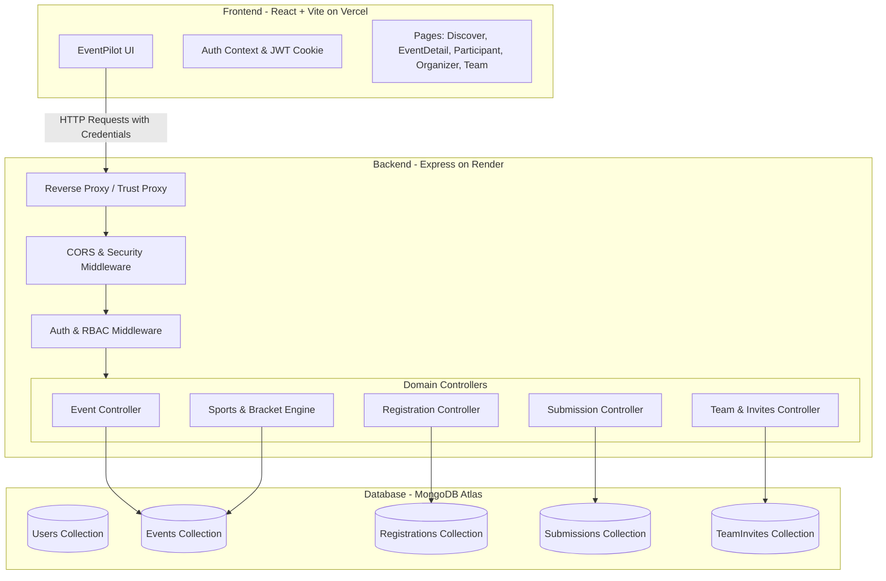

# EventPilot ✳

> **Next-Generation Event Operating System & Lifecycle Management Platform**  
> An end-to-end, full-stack application built for organizing, participating in, and managing competitive hackathons, sports tournaments, conferences, webinars, and community events.

[](file:///backend)
[](file:///frontend)
[](https://nodejs.org/)
[](https://react.dev/)
[](https://www.mongodb.com/)

---

## 1. Problem Statement
Traditional event ticketing platforms (e.g. Eventbrite, Meetup) only handle basic ticket purchases and generic QR check-ins. They fail to support the domain-specific lifecycle workflows required by real-world events:
1. **Hackathons** require project submission windows (GitHub repositories, deployed live demo links, video demos), judge evaluation portals, scoring rubrics, and dynamic live leaderboards.
2. **Competitive Sports & Esports** require team/squad registration limits, knockout bracket scheduling (Quarter-Finals ➔ Semi-Finals ➔ Grand Finals), automated winner progression, squad member invitation workflows, and points tables.
3. **Conferences & Webinars** need post-event knowledge hubs with executive summaries, key takeaways, slide deck links, and recording video archives.
4. **Organizer Teams** lack granular delegation controls to assign co-organizers, pause access, or securely manage admissions without sharing root administrator credentials.

**EventPilot** bridges this gap by providing a unified, multi-tenant event operating system tailored for hackathons, sports championships, webinars, and conferences.

---

## 2. Target Users
* **Lead Organizers & Event Directors**: Create events, configure capacities, manage co-organizers, evaluate hackathon project submissions, update tournament brackets, and publish recaps.
* **Co-Organizers / Delegated Staff**: Check in attendees, inspect participant rosters, and evaluate submissions without root administrative permissions.
* **Participants & Hackers**: Discover events, register for tickets, submit projects (GitHub, deployed apps, video demos), and track real-time leaderboard standings.
* **Team Captains & Squad Players**: Register team slots for competitive sports (Cricket 11 Playing XI, Football 11v11), send squad invitations to player dashboards, accept invites, and view live tournament brackets.

---

## 3. Core Workflows (Application Logic)

```text
┌────────────────────────────────────────────────────────────────────────┐
│                        EVENTPILOT CORE WORKFLOWS                       │
└────────────────────────────────────────────────────────────────────────┘

 [1. Hackathon Lifecycle]
 Kickoff Lock ──> Live Window (1 hr remaining) ──> Submit GitHub/Demo ──> Judge Evaluation ──> Official Leaderboard

 [2. Sports Tournament Engine]
 Team Registration ──> Knockout Fixtures ──> Match Scores (Crown 👑) ──> Winner Advances ──> Trophy Champion 🥇

 [3. Squad Formation & Invites]
 Captain Registers Team ──> Sends Invite to player1@ ──> Player Accepts on Dashboard ──> Squad Match Ticket Issued

 [4. Knowledge Recap Portal]
 Event Concludes ──> Organizer Posts Summary & Slides ──> Attendees Access Recordings & Insights

 [5. Organizer Delegation]
 Lead Organizer ──> Invites Co-Organizer (name.organiser@) ──> Toggle Active/Suspended ──> Access Revocation
```

### 1. Hackathon Lifecycle & Project Evaluation
* **Kickoff Lock**: Project submissions are strictly locked before kickoff and closed when the event ends.
* **Submission Portal**: Participants submit their project title, tagline, description, GitHub repository URL, deployed live application URL, and demo video link (or `N/A`).
* **Judge Scoring Rubric**: Organizers evaluate projects with numerical scores (0–100) and qualitative judge feedback.
* **Dynamic Leaderboard**: Published standings automatically rank projects with gold (🥇), silver (🥈), bronze (🥉), and top-tier rank badges.

### 2. Sports Tournament Engine & Bracket Progression
* **Tournament Formats**: Organizers configure 4-Team Knockout (`knockout_4`), 2-Team Match (`knockout_2`), 8-Team Knockout (`knockout_8`), or Round-Robin League (`round_robin`).
* **Team Slot Capacity**: Capacity represents team/competitor slots (e.g. 4 teams), with live availability (`Slots: 1 / 4 teams registered (3 slots remaining)`).
* **Automatic Winner Progression**: Marking a winner for **Semi-Final 1** automatically advances them to Team A of the **Grand Championship Final**; marking **Semi-Final 2** advances them to Team B.
* **Champion Crowning**: The resultant Grand Final winner dynamically triggers the celebratory **`🏆 TOURNAMENT CHAMPION 🥇`** gold banner.
* **Points Table Calculation**: Organizers can click **⚡ Auto-Calculate from Matches** to automatically compute Played (P), Won (W), Drawn (D), Lost (L), Points (PTS), and Cricket Net Run Rate (NRR).

### 3. Team Squad Formation & Request Acceptance
* **Captain Team Registration**: A team captain registers the team entry (consuming exactly 1 team slot).
* **Dashboard Squad Requests**: The captain can enter player emails, use quick player chips, or click **`⚡ Invite 11 Squad Players`**.
* **Player Acceptance**: Invited players see a pending card on their dashboard under **`🔔 Team Squad Invitations`** with **`[✓ Accept & Join Squad]`** and **`[✕ Decline]`**.
* **Squad Match Tickets**: Accepting issues an official ticket marked **`{TEAM_NAME} (SQUAD PLAYER 🏏)`**, and confirms them in the captain's roster.

### 4. Conference & Webinar Recap Portal
* Organizers can draft and publish executive summaries, bulleted key takeaways, slide deck URLs (Google Slides, Canva, PDF), and recording URLs (YouTube, Zoom cloud recordings).

### 5. Co-Organizer Access Delegation
* Lead organizers can invite co-organizers via `/organizer/team` with temporary passwords.
* Co-organizers can be paused (`suspended`) or reinstated (`active`) at any time without deleting accounts.

---

## 4. Technology Stack

### Frontend
* **Core**: React 19, JavaScript (ES2022)
* **Build Tool & Dev Server**: Vite 8 / Rolldown
* **Routing**: React Router v7
* **Styling**: Vanilla CSS Design System with CSS variables, sleek dark theme, glassmorphism cards, micro-animations, and full responsiveness.
* **Deployment**: Vercel (with `vercel.json` SPA client-side routing fallback).

### Backend
* **Runtime**: Node.js (v18+) with native ES Modules (`"type": "module"`)
* **Web Framework**: Express 4
* **Database & ODM**: MongoDB Atlas with Mongoose 8
* **Authentication**: JSON Web Tokens (JWT) signed with HMAC-SHA256, stored in secure, `httpOnly`, `sameSite: none` cookies (7-day validity).
* **Security & Hardening**:
  * Passwords hashed using `bcryptjs` with salt rounds.
  * Express `trust proxy` enabled for reverse proxies (Render, Cloudflare, AWS).
  * CORS origin verification supporting multi-origin configurations and Vercel domains (`*.vercel.app`).
  * HTTP security headers: `X-Content-Type-Options: nosniff`, `X-Frame-Options: DENY`, `Referrer-Policy: strict-origin-when-cross-origin`.
  * Rate-limiting on authentication and verification endpoints.
* **Testing**: Node Native Test Runner (`node --test`) for smoke and security tests.
* **Deployment**: Render Web Service.

---

## 5. Technical Architecture



---

## 6. Repository Structure

```text
EventPilot/
├── backend/
│   ├── src/
│   │   ├── config/          # Database connection and environment config
│   │   ├── controllers/     # Event, Auth, Registration, Submission, Team controllers
│   │   ├── middleware/      # Authentication, RBAC, and error handlers
│   │   ├── models/          # User, Event, Registration, Submission, TeamInvite schemas
│   │   ├── routes/          # Express route definitions
│   │   ├── scripts/         # Database seeding and migration scripts
│   │   ├── utils/           # Ticket generator, metrics, mailer, token helpers
│   │   ├── app.js           # Express app setup and middleware
│   │   └── server.js        # Server listener and MongoDB connection bootstrapper
│   ├── test/                # Node --test test suites
│   ├── .env.example         # Template for backend environment variables
│   └── package.json         # Backend dependencies and scripts
├── frontend/
│   ├── public/              # Static public assets
│   ├── src/
│   │   ├── components/      # Navbar, EventCard, Countdown, modals
│   │   ├── context/         # AuthContext provider
│   │   ├── lib/             # API client and date/category formatters
│   │   ├── pages/           # Discover, EventDetail, Dashboards, Forms
│   │   ├── App.jsx          # Router and app structure
│   │   ├── index.css        # Core design system and CSS tokens
│   │   └── main.jsx         # React application entrypoint
│   ├── .env.example         # Template for frontend environment variables
│   ├── vercel.json          # SPA routing fallback for Vercel
│   ├── vite.config.js       # Vite configuration
│   └── package.json         # Frontend dependencies and build scripts
├── README.md                # Project documentation and submission guide
└── package.json             # Root workspace scripts
```

---

## 7. Local Development Setup

### Prerequisites
* **Node.js**: v18.0.0 or higher
* **npm**: v9.0.0 or higher
* **MongoDB**: A local instance or free [MongoDB Atlas](https://www.mongodb.com/cloud/atlas) cluster URI.

### 1. Clone & Install
```bash
git clone https://github.com/Aniket30-07/EventPilot.git
cd EventPilot

# Install backend dependencies
cd backend
npm install

# Install frontend dependencies
cd ../frontend
npm install
```

### 2. Configure Environment Variables
Create `.env` in `backend/`:
```bash
cp backend/.env.example backend/.env
```
Fill in `backend/.env`:
```env
PORT=5001
NODE_ENV=development
MONGO_URI=mongodb+srv://<username>:<password>@cluster.mongodb.net/eventpilot?retryWrites=true&w=majority
FRONTEND_URL=http://localhost:5173
JWT_SECRET=super_secret_jwt_random_key_replace_for_production
```

Create `.env` in `frontend/`:
```bash
cp frontend/.env.example frontend/.env
```
Fill in `frontend/.env`:
```env
VITE_API_BASE_URL=http://localhost:5001/api
```

### 3. Seed Clean Test Data
To populate the database with the active Hackathon (1 hour remaining), 4-team Cricket tournament, Seminar, and demo accounts:
```bash
cd backend
node src/scripts/resetAndSeed.js
```

### 4. Run Locally
Open two terminal windows:

**Terminal 1 (Backend API):**
```bash
cd backend
npm run dev
# Running on http://localhost:5001
```

**Terminal 2 (Frontend Client):**
```bash
cd frontend
npm run dev
# Running on http://localhost:5173
```

---

## 8. Test Accounts & Evaluation Credentials

All accounts are pre-seeded in `backend/src/scripts/resetAndSeed.js`:

| Role | Email | Password | Pre-Registered Activity |
|---|---|---|---|
| **Lead Organiser** | `organiser1@gmail.com` | `organiser1@` | Event creation, bracket management, judging |
| **Participant 1** | `user1@gmail.com` | `user1@` | Registered in Live Hackathon (Ready to submit) |
| **Participant 2** | `user2@gmail.com` | `user2@` | Registered in Live Hackathon |
| **Participant 3** | `user3@gmail.com` | `user3@` | Registered in Cloud Architecture Seminar |
| **Cricket Player 1** | `player1@gmail.com` | `player1@` | Ready to receive & accept squad invitations |
| **Cricket Players 2–11** | `player2@gmail.com` .. `player11@gmail.com` | `player2@` .. `player11@` | Playing XI squad members |

---

## 9. Deployment Guide

### A. Deploying Backend to Render (Web Service)
1. Push your repository to GitHub.
2. Log into [Render Dashboard](https://dashboard.render.com/) and click **New +** ➔ **Web Service**.
3. Connect your GitHub repository (`EventPilot`).
4. Configure the Web Service settings:
   * **Name**: `eventpilot-api`
   * **Root Directory**: `backend`
   * **Environment**: `Node`
   * **Build Command**: `npm install`
   * **Start Command**: `node src/server.js` (or `npm start`)
   * **Plan**: `Free`
5. Add the following **Environment Variables** in Render:
   * `NODE_ENV`: `production`
   * `PORT`: `5000` (or leave default, Render sets `PORT` automatically)
   * `MONGO_URI`: `mongodb+srv://...` (your MongoDB Atlas connection string)
   * `JWT_SECRET`: A long random string (e.g. generated via `openssl rand -hex 32`)
   * `FRONTEND_URL`: `https://your-frontend.vercel.app` (your deployed Vercel frontend URL)
6. Click **Deploy Web Service**.
7. Note your live backend URL (e.g., `https://eventpilot-api.onrender.com`).

---

### B. Deploying Frontend to Vercel
1. Log into [Vercel Dashboard](https://vercel.com/) and click **Add New...** ➔ **Project**.
2. Import your GitHub repository (`EventPilot`).
3. In the project configuration:
   * **Framework Preset**: `Vite`
   * **Root Directory**: Click *Edit* and select **`frontend`**
   * **Build Command**: `npm run build`
   * **Output Directory**: `dist`
4. In the **Environment Variables** section, add:
   * `VITE_API_BASE_URL`: `https://eventpilot-api.onrender.com/api` (replace with your Render backend URL)
5. Click **Deploy**.
6. The included [frontend/vercel.json](file:///frontend/vercel.json) ensures that client-side page refreshes (e.g. `/events/123`, `/participant`) redirect cleanly without 404 errors.
7. Update `FRONTEND_URL` on Render with your final Vercel domain if needed.

---

## 10. Verification & Quality Checks

Run the automated test suite and production build check before submission:

```bash
# 1. Run Backend Unit & Security Tests (8/8 pass)
cd backend
npm test

# 2. Run Frontend Production Bundle Build
cd ../frontend
npm run build
```

---

## 11. Final Submission Checklist

- [x] **Working Software Application**: Live, multi-page application with complete state management and domain workflows.
- [x] **No Hardcoded Credentials**: Secrets, MongoDB URIs, and JWT keys are strictly stored in `.env` files.
- [x] **Robust Error Handling**: Express centralized error handlers, database validation checks, and clean UI feedback alerts.
- [x] **Git History**: Consistent, descriptive commit trajectory demonstrating incremental development.
- [x] **SPA Routing Fallback**: `vercel.json` configured for zero-error routing on Vercel.
- [x] **Production CORS & Cookie Security**: `trust proxy`, `sameSite: none`, and `secure: true` configured for cross-site Render + Vercel deployment.
- [x] **Documentation**: Complete problem statement, workflow diagrams, tech stack rationale, and setup guides.

---

## 12. Submission Form Details

```text
Project Name: EventPilot
Problem Statement: End-to-end event lifecycle operating system supporting domain-specific workflows for competitive hackathons, sports knockout tournaments, webinars, and organizer team delegation.
GitHub Repository: https://github.com/Aniket30-07/EventPilot
Tech Stack: React 19, Vite, React Router v7, Node.js, Express, MongoDB, Mongoose, JWT httpOnly Cookies, Vanilla CSS Design System.
Major Features:
  1. Hackathon project submission window, judge scoring rubric (0-100), and dynamic podium leaderboard.
  2. Sports tournament bracket engine (knockout/round-robin) with automatic winner progression and champion crowning.
  3. Team squad registration and request/invite acceptance system for 11-player squads.
  4. Conference and webinar executive recaps with slide decks and video recording distribution.
  5. Co-organizer team delegation with active/suspended permission controls.
```
